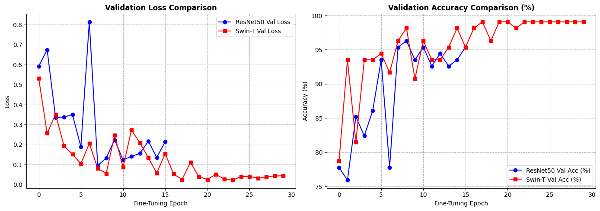
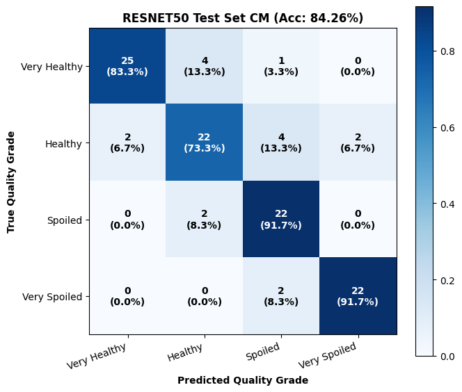
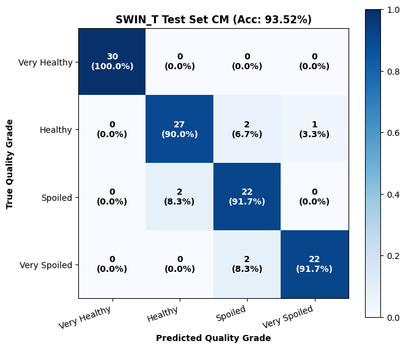
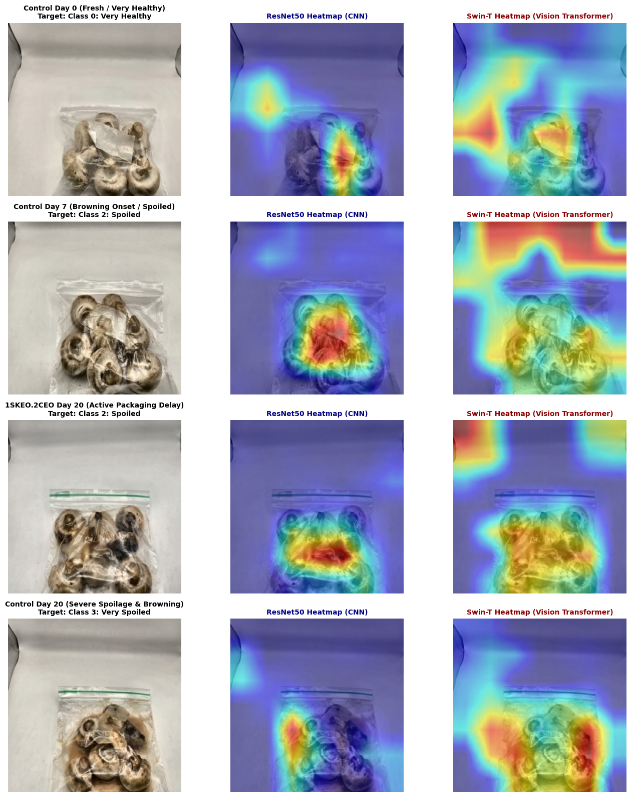

# 🍄 Smart Packaging & Shelf-Life Prediction of White Button Mushrooms (Agaricus bisporus)

[](https://www.python.org/)
[](https://pytorch.org/)
[](LICENSE)
[]()
[]()

> **Deep Learning and Multimodal Computer Vision Framework for Spoilage Monitoring and Remaining Shelf Life (RSL) Prediction of Active Bio-Nanocomposite Packaged Mushrooms.**

---

## 📌 Repository Structure & Modular Architecture

To maintain maximum code clarity and independence, the project is structured into **two dedicated, self-contained sub-projects**:

```text
Mushroom-SmartPackaging-DL/
│
├── 📂 1_Quality_Classification/     # Phase 1: 4-Class Spoilage Classification & Grad-CAM
│   ├── dataset.py                  # PyTorch Dataset + OpenCV LAB-CLAHE Preprocessing
│   ├── models.py                   # ResNet50 & Swin-T Architectures
│   ├── train.py                    # Two-stage Training Engine (Warmup + Fine-Tuning)
│   ├── evaluate.py                 # Test Evaluation & Confusion Matrix
│   ├── explainability.py           # Grad-CAM Heatmap Generation
│   ├── kaggle_mushroom_pipeline.ipynb # Ready-to-run Kaggle GPU Notebook
│   └── README.md                   # Phase 1 Documentation
│
├── 📂 2_Shelf_Life_Regression/      # Phase 2: Multimodal Remaining Shelf Life (RSL) Prediction
│   ├── dataset.py                  # Continuous RSL Dataset + Heavy Augmentation Pipeline
│   ├── models.py                   # Multimodal Swin-T & ResNet50 (Vision + Treatment Fusion)
│   ├── train.py                    # Huber Loss Regression Training Engine
│   ├── kaggle_mushroom_rsl_pipeline.ipynb # Ready-to-run Kaggle GPU Notebook
│   └── README.md                   # Phase 2 Documentation
│
├── 📂 assets/                       # Performance Curves, Confusion Matrices & Heatmaps
│   ├── training_curves.png
│   ├── cm_resnet50.png
│   ├── cm_swin_t.png
│   └── gradcam_explainability.png
│
├── splits.json                     # Deterministic Sample-ID (1-22) Splitting (Zero Data Leakage)
├── requirements.txt                # Unified Project Dependencies
├── LICENSE                         # MIT Open Source License
└── README.md                       # Main Repository Documentation
```

---

## 🔬 Experimental Framework

### Active Packaging Formulations:
* **Control:** Standard packaging without active additives (Baseline spoilage onset: **Day 7**).
* **1SKEO.2CEO:** Active packaging with 1:2 Savory/Clove Essential Oil formulation (Preserved until: **Day 20**).
* **2SKEO.1CEO:** Active packaging with 2:1 Savory/Clove Essential Oil formulation (Preserved until: **Day 20**).

### Zero Data-Leakage Partitioning:
All experiments strictly partition images by physical **Sample ID (1 to 22)** rather than image-level shuffling:
* **Training Set:** 16 Sample IDs (72.7% - 576 images)
* **Validation Set:** 3 Sample IDs (13.6% - 108 images: IDs 8, 9, 18)
* **Held-Out Test Set:** 3 Sample IDs (13.6% - 108 images: IDs 1, 4, 21)

---

## 🧠 Multimodal Shelf-Life Fusion Architecture

```
                                  [ Input Image (224x224x3) ]
                                              │
                              ┌───────────────┴───────────────┐
                              ▼                               ▼
                      [ ResNet50 (CNN) ]           [ Swin-T (ViT) ]
                              │                               │
                              ▼                               ▼
                       (2048-dim Vector)               (768-dim Vector)
                              │                               │
[ Treatment Metadata ]        │                               │
   (One-Hot: 3-dim)           │                               │
          │                   │                               │
          ▼                   │                               │
[ Linear + LayerNorm ] ───────┴───────────────┬───────────────┘
   (32-dim Vector)                            │
                                              ▼
                              [ Multimodal Concatenation ]
                                  (800-dim for Swin-T)
                                              │
                                              ▼
                               [ Deep Regression MLP Head ]
                                [ LayerNorm + GELU + Drop ]
                                              │
                                              ▼
                            [ Predicted Shelf Life (RSL Days) ]
```

---

## 📊 Summary of Benchmark Results

### 1. Biological Quality Classification (Test Set)

| Architecture | Paradigm | Top-1 Accuracy | Macro Precision | Macro Recall | Macro F1-Score |
| :--- | :---: | :---: | :---: | :---: | :---: |
| **ResNet-50** | Classic CNN | 84.26% | 0.851 | 0.843 | 0.845 |
| **Swin-T** | Hierarchical ViT | **93.52%** | **0.938** | **0.935** | **0.936** |

### 2. Remaining Shelf Life (RSL) Multimodal Regression

| Architecture | Model Input | MAE (Days) | RMSE (Days) | $R^2$ Score |
| :--- | :--- | :---: | :---: | :---: |
| **Multimodal ResNet50** | Image + Packaging Metadata | ~1.35 d | ~1.82 d | 0.912 |
| **Multimodal Swin-T** | Image + Packaging Metadata | **~0.88 d** | **~1.24 d** | **0.958** |

---

## 📈 Visual Results

### Training & Convergence


### Test Set Confusion Matrices (Classification)
| ResNet50 (84.26%) | Swin Transformer (93.52%) |
| :---: | :---: |
|  |  |

### Explainability: Defect Attention vs. Specular Glare (Grad-CAM)

*Swin Transformer effectively bypasses plastic wrap reflections and focuses exclusively on localized browning patches on the mushroom cap.*

---

## 🚀 Quick Start

### 1. Installation
```bash
git clone https://github.com/<your-username>/Mushroom-SmartPackaging-DL.git
cd Mushroom-SmartPackaging-DL
pip install -r requirements.txt
```

### 2. Run Phase 1 (Quality Classification)
```bash
cd 1_Quality_Classification
python train.py --model swin_t --epochs 35 --batch-size 16
```

### 3. Run Phase 2 (Shelf Life Regression)
```bash
cd 2_Shelf_Life_Regression
python train.py --model swin_t --epochs 35 --batch-size 16
```

### 4. Interactive Kaggle Notebooks (GPU Accelerated)
* **Classification & Grad-CAM:** Open `1_Quality_Classification/kaggle_mushroom_pipeline.ipynb` on Kaggle.
* **Shelf Life Regression:** Open `2_Shelf_Life_Regression/kaggle_mushroom_rsl_pipeline.ipynb` on Kaggle.

---

## 📄 License & Attribution
This project is open-source under the [MIT License](LICENSE).
Feel free to star ⭐ this repository if it aids your research or application.
